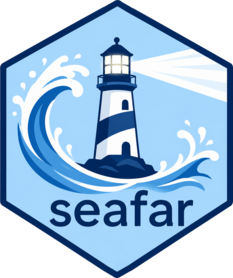

# seafar: Sparse Exploratory Approximate Factor Analysis for High-dimensional Data in R 

[](https://doi.org/10.5281/zenodo.20326841)

The package contains functions to perform a Sparse Exploratory Approximate Factor Analysis (SEAFA). These methods are implementations and extensions of the Regularized ESEM method ([Le et al., 2026](https://doi.org/10.3758/s13428-026-02960-y)) that uses approximate factor model with regularization (cardinality constraint and the LASSO penalty) to obtain simple structure for the loading matrix. A vignette was created as a tutorial paper for interested users.  

Please cite the package as shown in `CITATION.cff`.

## Installation instructions

The package can be installed from CRAN
```{r}
install.packages("seafar")
library(seafar)
```
The latest development version can be installed from GitHub as follows:
```{r}
install.packages("remotes")
remotes::install_github("trale97/seafar")
```

## Usage

The best way to get started with `seafar` is to follow the vignette. You can access it in R like this:

```r
library(seafar)
browseVignettes("seafar")
```

## Development guidelines

Contributions to the development of `seafar` are welcome. The author of the package will review all pull request. In this section, you can find the preferred development workflows for this package.

### Workflow for contribution

1. Create an issue on the `seafar` [GitHub issues page](https://github.com/trale97/seafar/issues) to describe you intended contribution.
2. Create a [branch for the issue](https://docs.github.com/en/issues/tracking-your-work-with-issues/using-issues/creating-a-branch-for-an-issue).
3. Create a [fork](https://docs.github.com/en/pull-requests/how-tos/work-with-forks/fork-a-repo#forking-a-repository) of `seafar` or sync your existing fork with the upstream repository
4. Make changes to the fork
5. Run a check with `devtools::check()`
7. Review any potential errors or warnings that are highlighted by the `devtools` report
8. Commit changes to the fork
9. Make sure the fork is up-to-date with the upstream branch (resolve any conflicts yourself)
10. Create a merge request to the branch of the issue on the upstream repository.

### Recommended workflow for submission of package to CRAN

We follow the main workflow highlighted in the [R Packages](https://r-pkgs.org/release.html#double-r-cmd-checking) book.

#### Run checks

1. [ ] `devtools::check(remote = TRUE, manual = TRUE)` on the computer you are using to develop the package, with the current version of R. It includes some extra checks usually turned off to make day-to-day development faster.
2. [ ] `devtools::check_win_devel(email = your@email.com)` on the computer you are using to develop the package. This will send the package to 

#### Update release documentation

1. [ ] Make sure you have update the version number in both [DESCRIPTION](DESCRIPTION) and [CITATION](https://github.com/trale97/seafar/blob/master/CITATION.cff).
2. [ ] Update the [NEWS.md](NEWS.md) or create one via `usethis::use_news_md()`.
3. [ ] `usethis::use_cran_comments()` to add a `cran-comments.md` to communicate to CRAN the output of the checks we have run.

#### Compile

In a terminal, compile the package running the following code in the parent directory of the cloned repository on your computer:

```bash
R CMD build seafar
```

This will create a seafar_x.y.z.tar.gz in the parent directory

#### Check again

Run a final check on seafar_x.y.z.tar.gz

```bash
R CMD check --as-cran seafar_x.y.z.tar.gz
```

#### Upload

Upload the seafar_x.y.z.tar.gz without errors and warnings to the [CRAN Submission Portal](https://cran.r-project.org/submit.html)

## Terms of use

This package is licensed under the MIT License.

The autism dataset is licensed under the terms specified in `R/autism.R`.
