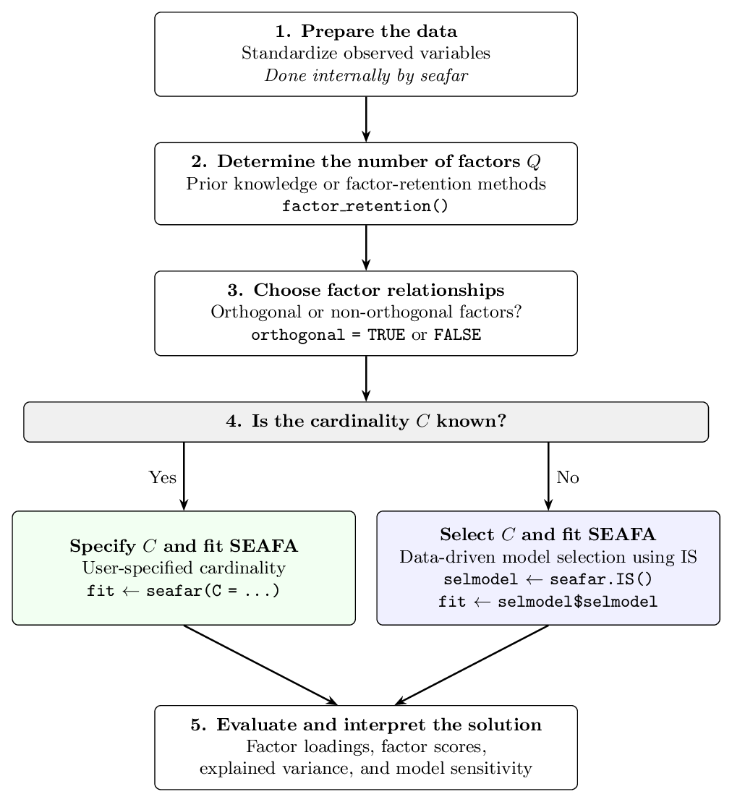
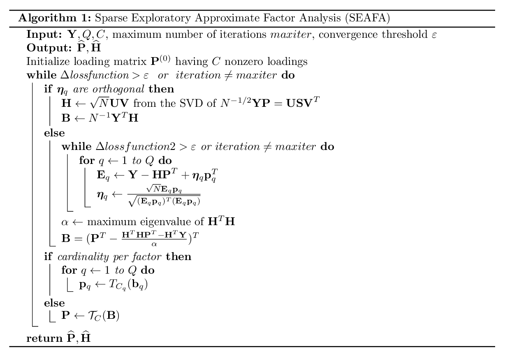
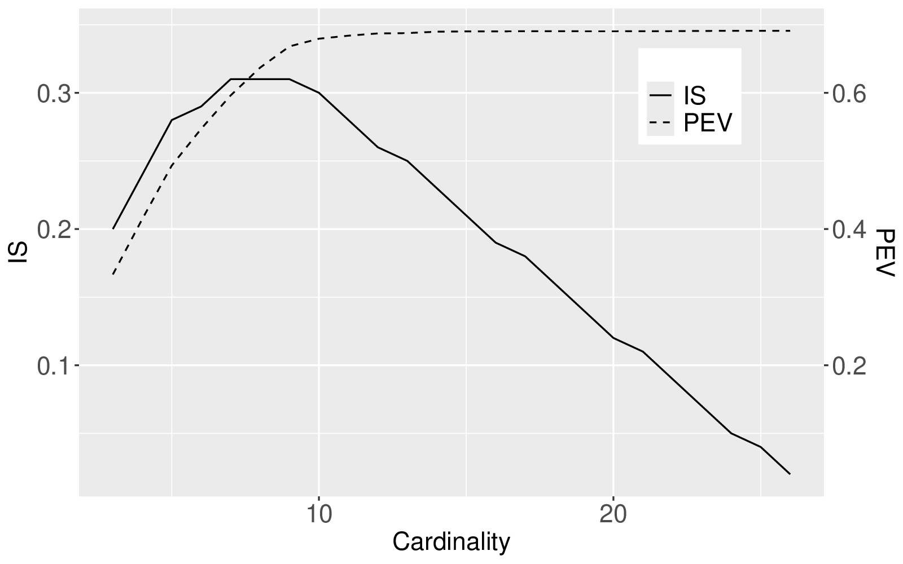
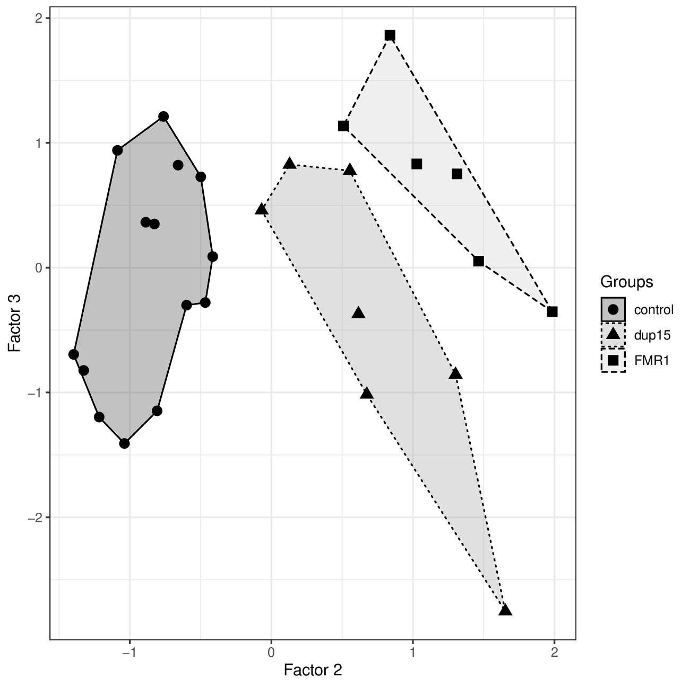

```{r, include = FALSE}
knitr::opts_chunk$set(
  collapse = TRUE,
  comment = "#>",
  warning = FALSE
)
```

```{=html}
<div class="title-meta">
  <p class="meta-heading">Authors</p>
  <p class="meta-heading">Affiliations</p>
  <p><a href="https://orcid.org/0000-0002-7700-8946">Tra T. Le</a></p>
  <p>Department of Methodology and Statistics, Tilburg University</p>
  <p><a href="https://orcid.org/0000-0001-9581-9913">Edoardo Costantini</a></p>
  <p>Research Support Team, Tilburg University</p>
  <p><a href="https://orcid.org/0009-0009-6939-411X">Stefan Kirsch</a></p>
  <p>Research Support Team, Tilburg University</p>
  <p><a href="https://orcid.org/0000-0002-2271-793X">Katrijn Van Deun</a></p>
  <p>Department of Methodology and Statistics, Tilburg University</p>
</div>
<div class="abstract">
  <p class="meta-heading">Abstract</p>
  <p>This document provides a step-by-step tutorial to use the package <em>seafar</em> to perform a Sparse Exploratory Approximate Factor Analysis (SEAFA). SEAFA is designed for exploratory research settings characterized by complex models with many unknown parameters, a large number of observed variables, limited sample sizes, and/or little prior knowledge about the underlying factor structure, where traditional factor analytic methods may perform poorly or become unstable. The document introduces the main functions in <em>seafar</em> and provides step-by-step guidance on its application as well as decisions that users need to make in each step.</p>
</div>
<div class="keywords">
  <p class="meta-heading">Keywords</p>
  <p>exploratory approximate factor analysis, regularization, high-dimensional data, R package</p>
</div>
```

# Introduction

The increasing availability of large-scale data and technologically advanced measurement tools has led to data sets containing more variables than observations, often referred to as low-sample-size high-dimensional data. In behavioral research, such data frequently motivate questions about the latent constructs underlying the observed variables. A natural framework for addressing these questions is exploratory factor analysis (EFA), which seeks to identify latent constructs that account for the covariance structure among observed variables [@morin2014esem]. Traditional EFA methods, however, may perform poorly in complex settings characterized by many unknown parameters relative to the sample size, particularly when little prior theoretical information is available and/or the sample size is limited. As a result, there has been growing interest in regularization-based methods that enable estimation in such situations. Examples include Penalized Factor Analysis in R [*penfa*, @geminiani2021; @penfa], Penalized Structural Equation Modeling in Mplus [PSEM, @asparouhov2024penalized], and Penalized Likelihood SEM in R [*lslx*, @JSSv093i07], among others.

@le2026exploratory recently proposed Regularized ESEM with the same general aim of conducting exploratory factor analysis for complex models and high-dimensional data. The method showed favorable performance relative to competing regularized approaches in recovering the simple structure of the loading matrix (i.e., correctly recovering which variables load on the factors and efficient estimation of the loadings), while also demonstrating stronger convergence behavior. Regularized ESEM conducts a two-stage procedure, in which the first stage estimates a measurement model followed by estimation of the structural model. The measurement model of Regularized ESEM essentially conducts a Sparse Exploratory Approximate Factor Analysis (SEAFA), which focuses on identifying sparse latent factor structures in exploratory settings.

Although Regularized ESEM was previously made available through a collection of R functions hosted on GitHub, its implementation may be challenging for applied researchers. To facilitate the application of SEAFA, the R package *seafar* provides an accessible implementation of the measurement model, with several modifications and extensions. First, whereas the original measurement model of Regularized ESEM used separate regularization approaches for orthogonal and non-orthogonal factors (i.e., cardinality constraint and the LASSO penalty), *seafar* provides a unified framework based on cardinality constraints for both settings. This choice was motivated by the cardinality-constrained approach's ability to produce exactly the number of (non)zero loadings prespecified by the users. This is not the case when using the LASSO penalty. Second, *seafar* includes the original model selection procedure based on the Index of Sparseness (IS), as well as an alternative warm-start strategy that can reduce computational time. The latter is especially helpful when the data set contains thousands of variables.

This vignette introduces the *seafar* package in R and provides a tutorial on how to use it to perform a SEAFA. We assume basic familiarity with exploratory factor analysis, including factor loadings and factor scores. The vignette demonstrates a full step-by-step analysis using the Holzinger and Swineford data [@holzinger1939] available from the *lavaan* package [@lavaan] as the central example. An additional example with the Autism Genetic data [@nishimura2007genome] was also included to demonstrate the ability of *seafar* to deal with (ultra) high-dimensional data and how results from *seafar* can be used in subsequent analyses. We conclude with practical recommendations and considerations for applying *seafar* in exploratory research.

# Step-by-step tutorial using *seafar*

In this section, we provide a step-by-step tutorial to conduct an analysis with SEAFA using the *seafar* package in R, including the decisions that users need to make in each step. The complete procedure is summarized in Figure 1. *seafar* can be installed as follows:

```{r, eval = FALSE}
install.packages("seafar")
library(seafar)
```

{width=65%}

```{r setup}
#| echo: false
library(seafar)
```

## Step 0: Prepare the data

The SEAFA algorithm requires input data (either matrix or data frame) to be arranged in a way such that the variables are in the columns and the observations are in the rows. Each variable is assumed to have a mean of zero and unit variance, which is made sure by all *seafar* functions internally. Here, we use the `HolzingerSwineford1939` dataset from *lavaan*:

```{r}
data(HolzingerSwineford1939, package = "lavaan")
HS_1939 <- HolzingerSwineford1939[, paste0("x", 1:9)]
```

## Step 1: Determine the number of factors Q

In order to fit a SEAFA model, the number of factors $Q$ needs to be specified. $Q$ can be determined either based on prior knowledge or by using different factor retention methods such as parallel analysis [@horn1965rationale], scree plot [@cattell1966scree], Kaiser-Guttman rule [@kaiser1960application], or a machine learning method [@goretzko2020one]. The *seafar* package provides a function to retain the number of factors based on the `nScree()` function from the *nFactors* package [@scree2025], with some modifications so that it can also work with high-dimensional data. `nScree()` provides results for different factor retention methods: the Kaiser criterion, parallel analysis, the optimal coordinates method, and the acceleration factor method. The last two are both non-graphical approaches to Cattell's scree test. The details are discussed in @raiche2013non. Users can also use any other methods or packages available to select the number of factors. We would like to point out that this is an important but often not straightforward task, since different methods can suggest different numbers of factors.

```{r}
Q <- factor_retention(data = HS_1939)
summary(Q)
```

## Step 2: Decide on the relationship between factors

In this step, users can decide if they wish to impose that the factors are orthogonal or non-orthogonal. We advise users to only impose orthogonality if they have prior knowledge for such relationship, in which case users need to specify option `orthogonal = TRUE` in every *seafar* function. Otherwise, it is a better option to let the relationship between the factors be freely estimated by SEAFA, which is the default option for all *seafar* functions.

## Step 3: Specify the cardinality

Fitting a SEAFA model requires the number of (non)zero loadings in the loading matrix, which can either be prespecified or tuned using data-driven methods.

### Step 3a: Analysis with known cardinality

In some cases, based on the construction of the questionnaire or the data, the desired number of nonzero loadings is known. For instance, with the `HolzingerSwineford1939` data, we assume a three-factor solution with a desired loading matrix showing each factor having three items load primarily on them. Thus, we can fit a SEAFA model with nine nonzero loadings as follows:

```{r, eval = FALSE}
fit <- seafar(
  data = HS_1939,
  nfactors = 3,
  C = 9
)
```

### Step 3b: Analysis with unknown cardinality

It is more common that the number of nonzero loadings $C$ is unknown, especially in an exploratory setting and/or when the number of observed variables is very large. Thus, $C$ needs to be tuned using the Index of Sparseness [@gajjar2017selection; @trendafilov2014simple]. That is, the algorithm searches through a sequence of candidate values for $C$ and chooses the one that maximizes the Index of Sparseness (IS), which is defined as follows

$$
\textrm{IS} = \textrm{PEV}_{\textrm{PCA}} \times \textrm{PEV}_{\textrm{SEAFA}} \times \textrm{PS},
$$

where $\textrm{PEV}_{\textrm{PCA}}$, $\textrm{PEV}_{\textrm{SEAFA}}$, and $\textrm{PS}$ are the proportion of explained variance using ordinary PCA, the proportion of explained variance using SEAFA, and the proportion of zero loadings, respectively. A suitable range of $C$ is $Q\times 3$ (at least three nonzero loadings per factor) to $J\times Q$.

Tuning $C$ can be performed using the `seafar.IS()` function, and the selected model can be directly extracted from the object as follows:

```{r}
select.model <- seafar.IS(
  data = HS_1939,
  nfactors = 3
)
fit <- select.model$selmodel # extract the selected model
summary(select.model)
```

`summary(select.model)` displays the chosen cardinality and the proportion of explained variance (PEV) of the data associated with this level of cardinality, as well as the PEV of the unconstrained model (i.e., no zero loadings). The evolution of PEV against the cardinality levels can be found in [Appendix B](#apx-PEVcard).

## Step 4: Evaluate and interpret the solution

Users can print the estimated loading matrix from the fitted object in Step 3a or 3b in the same fashion as follows:

```{r}
summary(fit)
```

The full factor score and loading matrices can be extracted by calling `fit$scores` and `fit$loadings`, respectively. This is useful when users wish to use the full factor scores and/or loadings for further analyses. [Appendix D](#apx-genetic) shows an example analysis with ultra-high-dimensional data (i.e., 43893 genetic marker variables for 27 subjects), in which the factor scores were extracted to show the separation among different autism groups.

# Options in the *seafar* package

Each *seafar* function used above has several extra arguments that users can change, which are summarized in Table 1. This section gives a detailed explanation of some of the main arguments.

Table: Table 1. Arguments of the functions in the *seafar* package

| Functions | Argument | Meaning |
|:-----------|:-------------|:--------------------------------------|
| All | `INIT` | Method to initialize starting values for the loadings: `"semirational"`, `"svd"`, `"random"` or `"rational"` |
| `seafar.IS()` | `warmstart` | `TRUE` to select the cardinality with warm starts (faster), `FALSE` to use the standard multi-start selection procedure (default is `warmstart = TRUE`) |
| All | `orthogonal` | Orthogonal (`TRUE`) or non-orthogonal (`FALSE`) factors (default is `FALSE`) |
| All | `nstarts` | Number of starts for multi-start procedure (default is 50 starts) |
| `seafar.IS()` | `TOL` | Decimals used to decide whether two PEV values are the same, used in the standard model selection procedure (default is `TOL = 3`) |
| `seafar.IS()` | `THR` | Threshold for the smallest nonzero loading during selection, used in the standard model selection procedure (default is `THR = 0.1`) |
| `seafar.IS()` | `card.length` | Maximum number of candidate cardinalities to test (default is `card.length = 100`) |
| All | `show_progress` | Show a progress bar (default is `show_progress = FALSE`) |

## The `INIT` argument

In all *seafar* functions, users can choose the method to initialize the starting values for the loading matrix by using the `INIT` argument with the following choices:

- `INIT = "rational"`: the initialization is inspired by the approach by @ding2004k where principal components can be interpreted as continuous relaxations of cluster membership indicators. Here, for the initialization of $\mathbf{P}$, an SVD-based (Singular Value Decomposition) loading matrix is first computed, which is then used to cluster the variables into $Q$ clusters. The resulting cluster structure is then used as a target for rotation, yielding a loading matrix with a simple structure with no cross-loadings. This choice is motivated by the common assumption in questionnaire data that items primarily load on a single latent factor with no cross-loadings [@reise2000factor]. The resulting rotated loading matrix is used as the initial loading matrix for SEAFA.
- `INIT = "random"`: the initial loading matrix has complete random values sampled from a multivariate normal distribution $MVN(\mathbf{0}, \mathbf{I})$.
- `INIT = "svd"`: the initial loading matrix is based on the SVD of the data, $\mathbf{Y} = \mathbf{U}\mathbf{D}\mathbf{V}^T$. Specifically, $\mathbf{P}_{init} = \frac{1}{\sqrt{N}}\mathbf{V}_Q\mathbf{D}_Q$, where $\mathbf{V}_Q$ and $\mathbf{D}_Q$ contain the first $Q$ right singular vectors and singular values, respectively. Every start for this method is identical, and only one start is used.
- `INIT = "semirational"`: a semi-rational initialization in which the initial loading matrix is constructed as a weighted combination of an SVD-based start (80%) and a random start (20%). The chosen weights emphasize the stability of the SVD-based start while introducing a modest amount of randomness.

## The `warmstart` argument

When using `seafar.IS()` to select the number of nonzero loadings $C$ using the IS, users can use the argument `warmstart` to toggle between the standard model selection proposed in @le2026exploratory and the procedure with warm start.

- `warmstart = TRUE`: SEAFA is fitted along a decreasing sequence of candidate values of $C$, with the loading matrix obtained at each value used as the starting value for the next, smaller value. Because each candidate requires only one fit rather than a full multi-start procedure, this strategy is considerably faster, which is especially helpful when the number of variables is large. The selected value of $C$ is the one that maximizes the IS. However, the results depend more strongly on the initial solution. The default initialization method is `INIT = "rational"` if nothing is specified.
- `warmstart = FALSE`: the standard procedure fits SEAFA with multiple starting values at each candidate value of $C$, in increasing order, and takes the value just before the smallest nonzero loading first falls below the threshold `THR` as a preliminary choice. Among all candidates with approximately the same PEV as this preliminary choice (i.e., rounded to `TOL` decimals), the value of $C$ with the highest IS is selected. Note that the selected cardinality might be sensitive to the value of `THR` specified. [Appendix C](#apx-sensi) shows a sensitivity analysis on the example data `HolzingerSwineford1939` with different values of `THR`. The default initialization method is `INIT = "semirational"` if nothing is specified.

# Discussion and conclusions

In this tutorial, we demonstrated how to perform exploratory factor analysis using the R package *seafar* in settings with a large number of observed variables (e.g., the Autism data set) as well as in settings with many unknown parameters to be estimated relative to the sample size, with little to no prior information on the loading structure and factors relationship. These are scenarios where *seafar* is most useful, while existing (regularized) EFA methods may struggle. The underlying algorithm of *seafar* builds on the approximate factor model and extends the recently proposed Regularized ESEM approach [@le2026exploratory]. In particular, *seafar* employs a cardinality constraint to impose simple structure on the loading matrix for both orthogonal and non-orthogonal factors. This constraint offers several advantages. First, it yields exact zero loadings, in contrast to rotation-based methods that rely on post-hoc thresholding of small but nonzero values. Second, it provides direct control over the number of nonzero loadings, whereas with the LASSO penalty, for instance, users do not know beforehand how many (non)zero loadings are associated with a particular level of penalty.

A limitation of the cardinality-constrained approach implemented in *seafar* arises in settings with non-orthogonal factors and a very large number of observed variables. Since the update of the loadings involves sorting the entire loading matrix to keep the $C$ elements with the largest absolute values, the computational time increases with the number of observed variables. Consequently, the LASSO-based approach proposed by @le2026exploratory still offers an attractive alternative in settings with non-orthogonal factors and many items. This method is also implemented as a separate function in *seafar* but is not discussed in detail here. Interested readers are referred to @le2026exploratory for the methodological derivation. An example illustrating the use of the LASSO approach in *seafar* is provided in [Appendix E](#apx-lasso).

The *seafar* package provides a user-friendly implementation of sparse exploratory factor analysis with minimal input requirements, along with built-in model selection procedures based on the Index of Sparseness. These procedures, suggested by RegularizedSCA [@gu2019regularizedsca] and Regularized ESEM [@le2026exploratory], allow users to determine the appropriate number of (non)zero loadings in the absence of strong prior theoretical guidance. The proposed package can be extended in several ways, for example to accommodate categorical variables, further broadening its applicability.

# Author note

The code used in this paper is publicly available at the GitHub repository <https://github.com/trale97/seafar>. The details of the two empirical data sets can also be found in this repository.

The authors have no competing interests to declare that are relevant to the content of this article.

This publication is part of the project SEM2.0 with file number 406.22.GO.022 of the Open Competition research program which is financed by the Dutch Research Council (NWO) under the grant <https://doi.org/10.61686/QDLYI03885>.

# References

<div id="refs"></div>

# Appendix A: Methodological background {#apx-method}

Here, we outline the SEAFA model and explain the use of regularization in the context of factor models.

## The SEAFA model

Let $\mathbf{y}$ denote a $J \times 1$ vector of standardized (i.e., mean zero and unit variance) scores on $J$ observed variables, $\mathbf{P}$ a $J \times Q$ factor loading matrix, and $\boldsymbol{\eta}$ a $Q \times 1$ vector of factor scores. The SEAFA model is expressed as:

$$
\mathbf{y} = \mathbf{P}\boldsymbol{\eta} + \boldsymbol{\epsilon} \tag{1}
$$

where $\boldsymbol{\epsilon}$ is the $J \times 1$ vector of residuals, assumed to have mean zero and to be uncorrelated with the factor scores.

In the classical common factor model underlying conventional EFA, residuals are typically assumed to be mutually uncorrelated. However, a large body of work in the econometric literature has pointed out that this assumption of uncorrelated residuals is overly restrictive in the high-dimensional setting (i.e., when the number of observed variables is very large). They instead proposed the approximate factor model that allows for weakly correlated^[Here, weakly correlated does not mean that every pairwise residual correlation must be close to zero. Rather, residual dependence must be sufficiently limited that it does not generate additional pervasive factors. Formally, this corresponds to the largest eigenvalue of the residual covariance matrix remaining bounded as the number of observed variables increases.] residuals and have shown that consistent estimation of this model is possible under a pervasiveness assumption (i.e., the average squared loading for each factor remains positive rather than approaching zero as the number of observed variables increases) [@bai2003inferential; @fan2021robust].

## Rotation and regularization

The approximate factor model in Equation (1) suffers the same rotational indeterminacy problem as the common EFA model: different orientations of the factors can represent the same relationships among the observed variables while producing different loading patterns. Additional restrictions or conventions are therefore needed to select a particular orientation. In conventional EFA, rotation techniques such as varimax or oblimin are typically used to seek simple structure by favoring solutions in which variables have relatively large loadings on only a small number of factors and small loadings on the remaining factors. These rotation procedures do not generally enforce exact zero loadings. Regularization provides an alternative way to encourage such simple structure during estimation itself. In Regularized ESEM, @le2026exploratory used a cardinality constraint for orthogonal factors and a LASSO penalty for non-orthogonal factors. The LASSO adds a penalty to the least-squares criterion that shrinks loadings toward zero, with sufficiently strong penalization producing exact zero loadings. The resulting number of (non)zero loadings is therefore controlled indirectly through the penalty parameter. A cardinality constraint instead specifies directly how many loadings are allowed to be nonzero. Both approaches can produce exact zeros, but the cardinality constraint gives direct control over their number. Because imposing sparsity through regularization may come at the cost of some loss in model fit, the balance between fit and interpretability should be evaluated for the application at hand.

Table: Table 2. Factor loadings obtained with rotation (oblimin) and regularization (cardinality constraint)

|      | Rotation: Visual | Rotation: Textual | Rotation: Speed | Regularization: Visual | Regularization: Textual | Regularization: Speed |
|:-----|:----:|:----:|:----:|:----:|:----:|:----:|
| X1 | 0.602 | 0.191 | 0.031 | 0.769 | 0 | 0 |
| X2 | 0.505 | 0.044 | −0.117 | 0.701 | 0 | 0 |
| X3 | 0.689 | −0.069 | 0.023 | 0.799 | 0 | 0 |
| X4 | 0.022 | 0.840 | 0.005 | 0 | 0.901 | 0 |
| X5 | −0.067 | 0.888 | 0.008 | 0 | 0.908 | 0 |
| X6 | 0.078 | 0.808 | −0.011 | 0 | 0.896 | 0 |
| X7 | −0.152 | 0.044 | 0.723 | 0 | 0 | 0.779 |
| X8 | 0.104 | −0.033 | 0.702 | 0 | 0 | 0.838 |
| X9 | 0.366 | 0.035 | 0.463 | 0 | 0 | 0.736 |

Table 2 illustrates the difference between conventional rotation (e.g., oblimin) and regularization (e.g., cardinality constraint) solutions obtained from the same dataset `HolzingerSwineford1939` [package *lavaan*, @lavaan]. Although the oblimin-rotated solution exhibits a relatively simple structure, several smaller cross-loadings remain. In practice, researchers often suppress small loadings when presenting results, but these loadings remain part of the fitted model. In contrast, the cardinality-constrained solution sets many smaller loadings exactly to zero, yielding a sparser loading structure. However, imposing sparsity may involve a trade-off with model fit, which should be considered when selecting the degree of regularization.

Building on Regularized ESEM, SEAFA imposes a cardinality constraint on the factor loading matrix for both orthogonal and non-orthogonal factor solutions to obtain simple structure in the loading solution. The objective function of SEAFA is as follows:

$$
\begin{aligned}
\arg \min_{\mathbf{H}, \mathbf{P}} \; & \|\mathbf{Y} - \mathbf{HP}^T\|_F^2, \\
\textrm{subject to } & \boldsymbol{\eta}_q^T\boldsymbol{\eta}_q = N \quad \forall q = 1,...,Q, \\
\textrm{and } & \textrm{Card}(\mathbf{P}) = C.
\end{aligned} \tag{2}
$$

To solve Equation (2), we use an alternating optimization (AO) scheme: factor scores $\mathbf{H}$ and loadings $\mathbf{P}$ are updated alternately while holding the other fixed.

### Conditional estimation of the factor scores

Update of the factor scores conditional upon fixed values for the loadings is based on the following objective:

$$
\begin{aligned}
\min_{\eta_{11},\ldots,\eta_{iq},\ldots,\eta_{NQ}} \; & \sum_{j=1}^J\sum_{i=1}^N\left(y_{ij}-\sum_q\eta_{iq} p_{jq}\right)^2 \\
\textrm{subject to } & \sum_i\eta_{iq}^2=N \quad \forall q=1,...Q.
\end{aligned} \tag{3}
$$

Equation (3) can be rewritten as the following equivalent problem:

$$
\begin{aligned}
\min_{\boldsymbol{\eta}_1,\ldots,\boldsymbol{\eta}_q,\ldots,\boldsymbol{\eta}_Q} \; & \|\mathbf{Y} - \sum_q \boldsymbol{\eta}_q \mathbf{p}_q^T\|^2 \\
\textrm{subject to } & \boldsymbol{\eta}_q^T\boldsymbol{\eta}_q = N \quad \forall q=1,...,Q.
\end{aligned} \tag{4}
$$

Using the method of Lagrange Multipliers, we obtain the Lagrangian function

$$
\begin{aligned}
\mathcal{L} &= \|\mathbf{Y}-\sum_q \boldsymbol{\eta}_q \mathbf{p}_q^T\|^2 - \mu(\boldsymbol{\eta}_q^T \boldsymbol{\eta}_q-N)\\
&= \|\mathbf{Y}-\sum_{t \neq q}\boldsymbol{\eta}_t\mathbf{p}_t^T - \boldsymbol{\eta}_q\mathbf{p}_q^T\|^2 - \mu(\boldsymbol{\eta}_q^T \boldsymbol{\eta}_q-N)\\
&= \|\mathbf{E}_q - \boldsymbol{\eta}_q\mathbf{p}_q^T\|^2 - \mu(\boldsymbol{\eta}_q^T \boldsymbol{\eta}_q - N)
\end{aligned} \tag{5}
$$

Solving $\frac{\partial \mathcal{L}}{\partial \boldsymbol{\eta}_q} = 0$ and $\frac{\partial \mathcal{L}}{\partial \mu} = 0$, we have $\boldsymbol{\eta}_q = \frac{\sqrt{N}\mathbf{E}_q\mathbf{p}_q}{\sqrt{(\mathbf{E}_q\mathbf{p}_q)^T(\mathbf{E}_q\mathbf{p}_q)}} \quad \forall q = 1,...,Q$.

### Conditional update of the factor loadings

The update of factor loadings conditional upon fixed values for the scores is based on the following objective:

$$
\begin{aligned}
\min_{\mathbf{P}} \; & \|\mathbf{Y} - \mathbf{HP}^T\|_F^2 \\
\textrm{subject to } & \textrm{Card}(\mathbf{P}) = C,
\end{aligned} \tag{6}
$$

which can be rewritten in vectorized form as follows:

$$
\begin{aligned}
\min_\mathbf{P} \; & \|\textrm{vec}(\mathbf{Y}) - (\mathbf{I}\otimes \mathbf{H})\textrm{vec}(\mathbf{P}^T)\|_2^2, \\
\textrm{subject to } & \textrm{Card}(\mathbf{P}) = C.
\end{aligned} \tag{7}
$$

As pointed out by @adachi2017sparse, Equation (7) can be majorized as follows:

$$
\|\textrm{vec}(\mathbf{Y}) - (\mathbf{I}\otimes \mathbf{H})\textrm{vec}(\mathbf{P}^T)\|_2^2 \leq c + \alpha\|\mathbf{b} - \textrm{vec}(\mathbf{P}^T)\|_2^2, \tag{8}
$$

where the right-hand side function is also known as the surrogate function. Here, $c$ is a constant with respect to $\mathbf{P}$, $\alpha$ is the maximum eigenvalue of $\mathbf{H}^T\mathbf{H}$. $\mathbf{b}$ is derived as follows:

$$
\begin{aligned}
\mathbf{b} &= \textrm{vec}(\mathbf{P}^T_{old}) - \frac{1}{\alpha}\left((\mathbf{I} \otimes \mathbf{H})^T(\mathbf{I} \otimes \mathbf{H})\textrm{vec}(\mathbf{P}^T_{old}) - (\mathbf{I} \otimes \mathbf{H})^T \textrm{vec}(\mathbf{Y})\right)\\
&=\textrm{vec}(\mathbf{P}^T_{old}) - \frac{1}{\alpha}\left((\mathbf{I} \otimes \mathbf{H}^T)(\mathbf{I}\otimes \mathbf{H})\textrm{vec}(\mathbf{P}^T_{old}) - (\mathbf{I} \otimes \mathbf{H}^T)\textrm{vec}(\mathbf{Y})\right) \\
&=\textrm{vec}(\mathbf{P}^T_{old}) - \frac{1}{\alpha}\left(\mathbf{I} \otimes (\mathbf{H}^T\mathbf{H})\textrm{vec}(\mathbf{P}^T_{old}) - \textrm{vec}(\mathbf{H}^T\mathbf{Y})\right)\\
&=\textrm{vec}(\mathbf{P}^T_{old}) - \frac{1}{\alpha}\left(\textrm{vec}(\mathbf{H}^T\mathbf{HP}^T_{old}) - \textrm{vec}(\mathbf{H}^T\mathbf{Y})\right) \\
&= \textrm{vec}\left(\mathbf{P}^T_{old} - \frac{1}{\alpha}(\mathbf{H}^T\mathbf{HP}^T_{old} - \mathbf{H}^T\mathbf{Y})\right),
\end{aligned}
$$

or in matrix form as

$$
\mathbf{B} = \mathbf{P}_{old} - \frac{1}{\alpha}(\mathbf{P}_{old}\mathbf{H}^T\mathbf{H} - \mathbf{Y}^T\mathbf{H}), \tag{9}
$$

where $\mathbf{b} = \textrm{vec}(\mathbf{B}^T)$. Let $k = J\times Q - C$ be the number of zero loadings in $\mathbf{P}$ and $|b|_{(k)}$ is the $k$-th smallest element of $\mathbf{B}$. Then the update of $\mathbf{P} = (p_{jq})$ is

$$
p_{jq} = \begin{cases}
  b_{jq}, & \textrm{if } |b_{jq}| \leq |b|_{(k)},\\
  0, & \textrm{otherwise}
\end{cases} \tag{10}
$$

The AO procedure results in a non-increasing sequence of loss values. However, as Equation (2) is not a convex problem, the algorithm is subject to local minima. Thus, we implement the algorithm with a multi-start procedure: the algorithm is run several times with different starting values and the solution with the lowest value is retained as the final solution. The complete procedure is summarized in Algorithm 1.

{width=70%}

# Appendix B: The evolution of PEV against the cardinality levels {#apx-PEVcard}

{width=65%}

As can be seen from Figure 2, the IS peaked at three values of $C = 7, 8$ and $9$. $C = 9$ was selected as it had the highest PEV among the three solutions.

# Appendix C: Sensitivity analysis for different values of `THR` when selecting the cardinality {#apx-sensi}

Table: Table 3. Selected cardinality for different values of `THR` ($Q = 3$, `TOL = 3`)

| `THR` | Selected cardinality $C$ |
|:-----:|:-----:|
| 0.01 | 20 |
| 0.03 | 18 |
| 0.05 | 18 |
| 0.10 | 13 |
| 0.15 | 13 |
| 0.20 | 13 |
| 0.30 | 10 |
| 0.40 | 10 |

# Appendix D: Analysis with the Autism genetic dataset {#apx-genetic}

As the *seafar* package was developed to specifically deal with high-dimensional settings, we also demonstrate how it can be used to analyze the Autism Genetic dataset [@nishimura2007genome]. The data is publicly available at <https://www.ncbi.nlm.nih.gov/geo/query/acc.cgi?acc=GSE7329>. The data was preprocessed by removing three individuals who were mislabeled and standardizing each column of the data to have a mean of zero and a variance of one (as done in @guerra2023sparsifying)^[The detailed steps to retrieve the data from source and preprocess it can be found by calling `?autism`.]. The resulting data set contains 43893 genetic marker variables for 27 subjects, in which 14 individuals are in the control group, six are in the FMR1-FM autism group, and seven are in the dup15q autism group. This final data set can be loaded directly from the *seafar* package as follows:

```{r, eval = FALSE}
library(seafar)
data("autism")
```

We chose three factors as indicated in the original paper by @nishimura2007genome and imposed orthogonality on them. Due to the size of the data set, we perform a model selection with warm start to determine the number of nonzero loadings from 200 candidate values:

```{r, eval = FALSE}
select.autism <- seafar.IS(
  data = autism,
  nfactors = 3,
  orthogonal = TRUE,
  card.length = 200
)
fit.autism <- select.autism$selmodel
autism.scores <- fit.autism$scores
```

The factor scores were extracted, and Figure 3 shows a plot of Factor 2 and Factor 3 plotted against each other. As can be seen, Factor 2 clearly separated the control group and the two autism groups. This reflects the same results by @nishimura2007genome, without having to use a filtering step (i.e., @nishimura2007genome conducted an ANOVA to select a subset of 293 genetic markers that maximally discriminated between the three groups, which were then used in a PCA).

{width=55%}

# Appendix E: Demonstration of using the LASSO penalty in the *seafar* package {#apx-lasso}

Instead of performing a model selection procedure to choose the number of (non)zero loadings, SEAFA with the LASSO penalty requires tuning the penalty parameter. This can also be done using the Index of Sparseness by running the following lines:

```{r}
select.lasso <- is.seafar_lasso(
  data = HS_1939,
  nfactors = 3,
  lambda.length = 10
)
fit.lasso <- select.lasso$selmodel
summary(fit.lasso)
```

All additional arguments are the same as in Table 1, except `card.length` is replaced with `lambda.length` to specify the number of LASSO tuning parameters to evaluate in the model selection with the IS. The default is 50 values (if `lambda.length` is not specified). As can be seen in the printed output, the IS chose the LASSO penalty parameter that resulted in a higher number of nonzero loadings than the cardinality-constrained approach. The simulation study in Regularized ESEM [@le2026exploratory] also reported this discrepancy between the two approaches. Interested readers are referred to @le2026exploratory for the discussion on the differences in technical details and results of the two.
